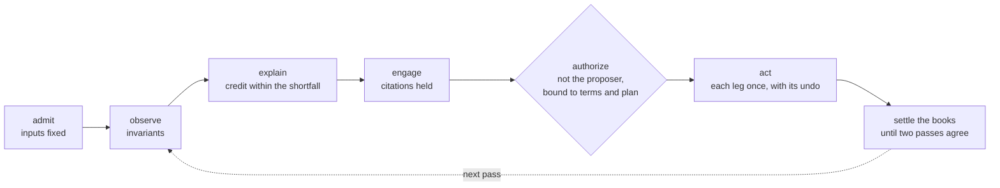
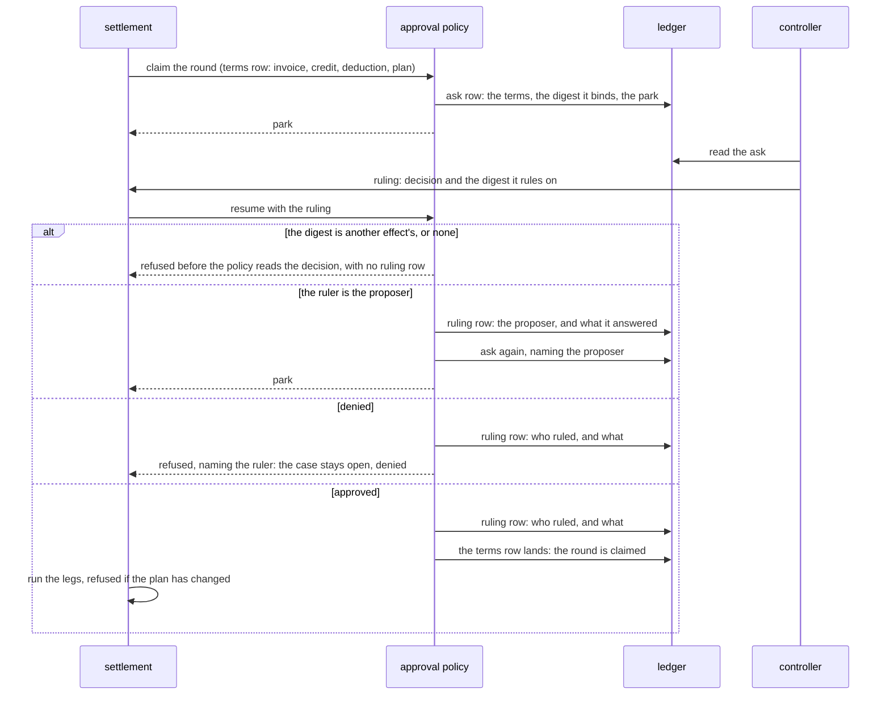
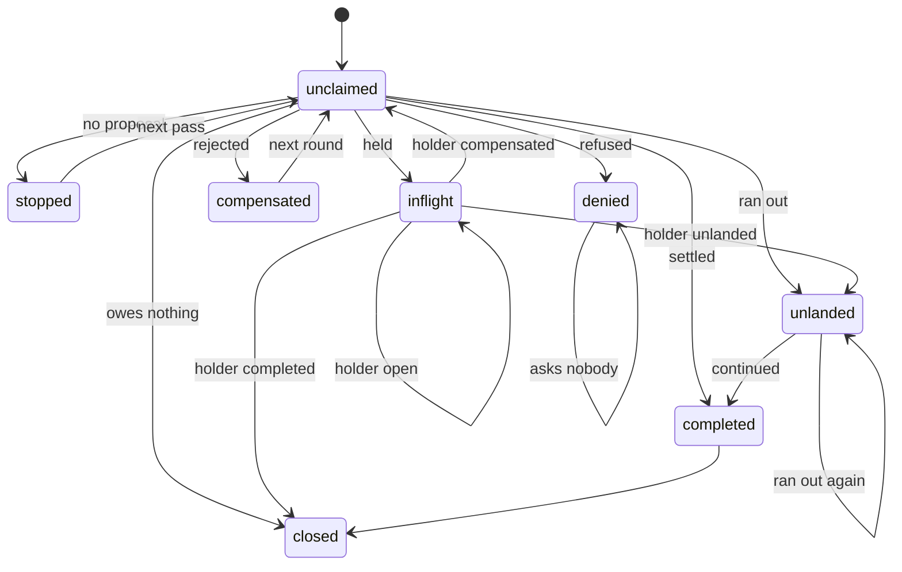

# The agent firm

An agent firm is a top-down organization of agents whose substrate keeps the tape, the budget and
the verdict. Its worked example is an accounts-receivable firm, `src/examples/agent_firm/`: a
customer pays short of an invoice, and the firm explains the gap, has an outside critic check
the explanation against the contract, parks the settlement for an approver other than its
proposer, and settles the case by saga through an ERP port. `uv run python -m
examples.agent_firm sla-cap` runs one case; the module docstring has the others.

## The composition

| stage | combinator | module |
|---|---|---|
| admit | a manifest of the run's inputs in its spawn params: the case by content, the round, the knowledge snapshot it reads, the arm, code, models and budget | `manifest.py` |
| know | `load_knowledge`: the pinned snapshot of the firm's rules, read at a recorded step and refused when its contents do not hash to the pin | `knowledge.py` |
| observe | `reconcile`: a `gather` over the cases, each held to the invariants | `reconcile.py` |
| explain | an ask through a `Gated` channel: a credit within the shortfall, on the case's documents and the firm's rules | `engage.py`, `resolve.py` |
| engage | an outside critic's review of the proposal, re-asked with the reason when a citation is not held: a `fixpoint` under `repair:engage`, one level per ask | `engage.py`, `critic.py` |
| claim | the round, read and then claimed on the ledger by the settlement's claimant, a name minted from its task and placement that replay reads back: a settlement whose round another holds ends `Superseded` whatever its credit, before it asks when the read finds the holder and at the claim when the holder claimed after the read | `ar.py` |
| authorize | a `govern` policy parking the claim on any case that breaks an invariant, a $0 credit included, until a principal other than its proposer approves it; the ask names the credit and the deduction and binds the digest of the terms row, which carries the digest of the settlement's plan, and the ruling names that digest, so a credit nobody approved holds no round and a plan nobody approved runs no leg (ADR-0028); each ask and each ruling is a ledger row, paired by pass | `resolve.py` |
| act | `saga` over the legs built from the settlement's plan, which is data: compensable legs, at most one pivot, then retriable legs, checked at construction; a retriable leg is a `fixpoint` under `retry:{leg}`, one level per attempt, which a grantor may extend | `saga.py`, `ar.py` |
| end | how the settlement ended, appended to the ledger once its saga does: completed, compensated or unlanded; a round after the first opens only once the round before it ended compensated | `ar.py` |
| settle the books | `firm`: a `fixpoint` under `firm:{books}` whose passes advance every open case concurrently by what the ledger says of its rounds, until two passes leave the same cases open in the same rounds for the same reasons, none of them unlanded or compensated, or the pass budget runs out (ADR-0027) | `firm.py` |

| leg | kind | ERP op or tool | undone by |
|---|---|---|---|
| `credit-memo` | compensable | `PostMemo` | `Reverse` |
| `apply-payment` | compensable | `Apply` | `Unapply` |
| `apply-memo` | compensable | `Apply` of the memo's entry | `Unapply` |
| `notify` | pivot | the customer's notice | nothing |
| `remind` | retriable | a collection notice for what is still owed | nothing |

Every leg is a step keyed by the fact it is about: the case's invoice and payment in a round of
its books, the leg, and its attempt. A step resumed after a crash reaches the ERP or the customer
under the key it was first sent with. One settlement owns a round: a second settlement of it
performs nothing, so no other settlement's apply can land between the owner's unapply of the memo
and its reversal. A settlement that cannot recover is another process's to finish. A refused spend
ends a retry or a repair and is raised, since every later metered op is refused the same way.
`settlement` takes a grantor for the collection, and no resolution passes one yet.



## Approval

The op an approval gates is the settlement's claim of its round: the terms row, which names the
invoice, the credit, the deduction and the digest of the settlement's plan. The policy parks the
claim with an ask that binds the digest of that row, and the ruling has to name the same digest.



A ruling on another effect is refused before the policy reads its decision, so an approval of $500
cannot release a claim of $1,000, and an approval of one plan cannot release another. The ruler is
a name the answering surface asserts, and authenticating it is the host's. The
binding's law is on [concepts/authority](authority.md).

## Sagas and compensation

A settlement's plan is data: a list of planned legs, each with its kind, the ERP op or tool it
sends and the op that undoes it, and its digest is what the terms row carries. The saga runs the
legs in order. When a leg is rejected, it undoes the legs that landed, latest first, so the memo is
unapplied from the invoice before it is reversed.

| ending | when | what the books hold | next |
|---|---|---|---|
| completed | every leg landed | the memo and both matches | the case closes |
| compensated | a leg was rejected | every posted entry; the memo matched to its reversal, the payment unapplied | the next round resolves the case again |
| unlanded | a retriable leg ran out of attempts | what landed before it | the next pass continues the leg under the round's keys |

The residuals on the `sla-cap` case: $100,000 invoiced, $97,000 paid, $3,000 deducted, and a
$1,000 credit, the contract's cap on an outage credit.

| entry | after a completed settlement | after a compensated one |
|---|---|---|
| invoice | $2,000 owed | $100,000 owed |
| payment | $0 unapplied | $97,000 unapplied |
| credit memo | $0 | $0, matched to its reversal |
| reversal | | $0 |

No posted entry is deleted: a compensation posts a reversal beside the memo. A reversal whose memo sits in
a locked period posts in the open period (closed-period reversal handling). Every leg is sent
under a key naming the case, the round, the leg and its attempt, so a leg resumed after a crash
reaches the ERP under the key it was first sent with.

## The firm settles to a fixpoint

A case's state is the ledger's, so a pass reads it round by round and acts on what it finds.

| the ledger says of the case | the pass | the case is |
|---|---|---|
| its latest round completed | does nothing | closed |
| a round claimed and not ended | does nothing | open, in flight |
| its latest round ended unlanded | continues the leg that did not land, under the round's keys, as a numbered continuation | as the leg ends |
| its latest round compensated | resolves the case in the next round | as resolved |
| no claim of its first open round | reads the invoice's statement, and resolves the case there unless the invoice owes nothing | as resolved |

A settled case can still owe, since a credit smaller than the deduction leaves the rest reminded,
so the books cannot say whether the firm is done with a case; the statement says what the firm did
not do, such as a second payment. A denied case stays open and the next pass asks nobody; only
the approval's refusal of the round's claim, on a ruler's word, is a denial, and it names the ruler. `Converged` with open cases is the firm's
dissent, each open case stopped, denied or in flight; the firm passes again while a case is
unlanded or compensated, and answers `Unconverged` when the budget runs out first. Two runs of the
firm, the first converged with every case closed, equal one in the books and in what the customer
is told; they differ in
the reads each records.

A pass maps the open cases $B_n$, each with its round and why it is open, to $B_{n+1}$. The firm
stops when a pass changes nothing and no open case is unlanded or compensated, the two endings the
next pass is certain to act on:

```math
\mathrm{settled}(B_n, B_{n+1}) \iff B_{n+1} = B_n \;\land\; \forall o \in B_{n+1}.\ \mathrm{last}(o) \notin \{\mathsf{unlanded}, \mathsf{compensated}\}
```

Stopping is two passes agreeing, and a later pass can still change a case it leaves open: a stopped
case is asked again on every pass, so a usable answer closes it, and a case in flight follows its
holder (`test_a_case_the_firm_left_stopped_closes_on_a_later_pass`,
`test_a_case_in_flight_follows_its_holders_ending`). The budget bounds the number of passes; a pass
that waits on an approval waits as long as the approver does.

A settlement that raises, as a rejected undo does, appends no ending, so its round reads as claimed
and the case as in flight on every later pass, and the firm's run over the books fails with it.



A held round follows its holder's ending: a completed one closes the case, a compensated one
sends it to the next round, and an unlanded one is continued by the pass that finds it.

## Knowledge and the factors

Knowledge (K) is a stock. A snapshot of the firm's rules is read by digest at a recorded step, so a replay
reads the rules the first attempt read whatever the store has gained since. An adoption reads its parent's row, then claims
`knowledge-adopted:{books},{height}` on the ledger, naming parent, child and adopter: one whose
parent is not the snapshot at the height below is unlinked, the first adopter to claim a height
holds it, and one with another child is outrun. A read answers from the reader's own lineage, and a
claim of an id the other lineage holds is refused, so a hypothetical adoption neither moves the
canonical head nor answers a canonical adopter. The driver folds the
head by reading adoptions upward and admits a run there; the run never reads the head itself.

`factors.py` projects one resolution's factors of production from the record that holds each:
assignment from the manifest, human judgment (H) from the ask and ruling rows of the run's own
lineage, agent labor (A) from the tape's model steps and capital (C) from their recorded spend,
knowledge (K) from the pin. `score.py` reads the outcome (Y) off the books against each case's gold
credit, outside the firm, so a superseded run scores as the credit its round holds. `interaction`
measures how much more the critic moves the outcome with the SLA rule held than without, from each
run's manifest, given both arms' snapshots, and refuses a stray run, a doubled outcome, or a
missing one. The letters are the production function's:

```math
Y = f(H, A, C, K \mid O, T)
```

The outcome $Y$ depends on human judgment, agent labor, capital and knowledge, given the
organization $O$ and the task mix $T$. What the record measures is a proxy for each factor, and
narrower than it:

| factor | in theory | the proxy the firm records |
|---|---|---|
| $H$ | the principal's attention and judgment | the asks and rulings, and who ruled each |
| $A$ | the work agents do | the committed model calls |
| $C$ | what the work consumes | the committed calls' recorded spend; a call lost before its record is missing |
| $K$ | the firm's rules and procedures | the pinned snapshot |
| $Y$ | the value of the accepted result | the dollars between the credit standing on the books and the case's gold credit, negated so that more is better |

The interaction contrast compares a critic-enabled organization $o_1$ with one without, $o_0$,
under two snapshots of the rules, $K_1$ with the SLA rule and $K_0$ without:

```math
I = \bigl[Y(o_1, K_1) - Y(o_0, K_1)\bigr] - \bigl[Y(o_1, K_0) - Y(o_0, K_0)\bigr]
```

`interaction` takes one outcome per cell, so it computes the contrast and estimates nothing: a mean,
its uncertainty, or a population claim needs an experiment. A nonzero $I$ says the critic's effect
depends on the rule. A positive $I$ makes the two complements; a rule that makes the critic unnecessary improves the firm by substitution, and its
$I$ is negative.

## The ERP port

`erp/port.py` is a typed port: its ops are answered by `Posted`, `Applied`, `Unapplied`,
`Statement` or `Refused`. One adapter (`erp/odoo.py`) runs over two transports, XML-RPC to Odoo Community in the
pod `just odoo-up` starts, and a scripted Odoo (`erp/scripted.py`) that answers the same calls in
memory.

| clause | what holds |
|---|---|
| a post or a reversal lands once per key | the key is claimed by creating its unique `ir.model.data` row; a draft loaded without the key loses to the claim and is deleted |
| an apply lands once per key, and an unapply once per apply it names | each claims the apply's key in an `ir.model.data` module naming what it records, from one server action that makes or removes the match in the same transaction; an apply whose undo's claim is held is `Refused`, as a post whose memo was reversed is |
| a match is owned by its claims | an apply holds each match it made or found, in a row Odoo deletes with the match; an unapply releases its key's holds and removes a match no other key holds, and says whether it removed it; the last release removes the match whoever made it |
| fence runs on one invoice serialize | each writes the invoice's row first, so Odoo retries the later of two overlapping runs on a snapshot holding the earlier one's claims and holds; three races held open on live Odoo pin it |
| a read lands nothing | `Read` answers what the invoice owes and the entries on its customer's account, as they stand, under any key |
| a refusal is data | `Refused` carries a reason and the values it is about, and nothing lands |
| a key names one move | an op whose key names a move differing in kind, customer, amount or original is `Refused`, and the move stands |
| a fault is unknown | a call whose outcome could not be read raises `Unknown`, and the replay resolves it |

On Odoo Community each op is one of the accounting moves a bookkeeper would make by hand:

| op | on Odoo |
|---|---|
| `PostMemo` | a customer credit note (`out_refund`): loaded as a draft carrying its key, the key claimed, then posted |
| `Reverse` | a move of the mirrored type naming the original in `reversed_entry_id`, posted the same way |
| `Apply` | a partial reconcile (`account.partial.reconcile`) of the payment or the memo against the invoice, made in the fence with its claim |
| `Unapply` | the removal of that partial reconcile, in the fence, when no other key holds it |
| `Read` | the invoice's residual and the entries on its customer's account |

Two rounds of one case can meet on one match: an earlier round's late unapply and a later round's
apply that adopted the match. The match is owned by its claims ([ADR-0027](../../docs/adr/0027-the-firm-settles-to-a-fixpoint.md) §2), so an unapply
releases only its own key's hold. `formal/quint/erp_claim.qnt` checks that protocol over every
interleaving of two attempts in each of two rounds, reaching every state of the model within its
30-step bound: the books hold the decision once settled, a live claim has its match, no round opens before the one before it ended, and a case
is credited once. It assumes an attempt whose lease expired writes no checkpoint, and that one
landing is one whole fence run, which the fence's serialization per invoice makes true. Exactly-once
is per receiver: it rests on Odoo's unique keys and the fence, and another ERP needs its own
protocol.

## The controls the tests check

| control | what holds | pin |
|---|---|---|
| crash-safe settlement | a settlement posts one memo and applies it and the payment once, at every crash point, on both engines and both ERPs, so the invoice owes the gap less the credit | `tests/test_agent_firm_saga.py`, `tests/test_agent_firm_resolve.py` |
| evidence doesn't move money | the firm's committed effects do not read the notes and tickets, over generated variants of them | `tests/test_agent_firm_resolve.py` |
| a review acts through its answer | a critique changes the run at its own result and nowhere else; an uncited one posts nothing | `tests/test_agent_firm_resolve.py` |
| deduction review | a critic finds the contract's cap on the customer's deduction, and its run replays without asking a model | `tests/test_agent_firm_engage.py` pins the program, and replays the three haiku runs `src/examples/agent_firm/deduction_review.py` banked from a live model, each finding the cap |
| separation of duties | an approval by the proposer does not count, and the memo parks again | `tests/test_agent_firm_resolve.py` |
| approved as asked and planned | a resume deriving other terms, or under a plan with a step added, removed or changed, is refused before any leg, and so is a continuation under a changed plan; another policy's refusal in the approval's words is no denial. `formal/quint/plan_license.qnt` checks that every leg sent is the plan the ruling named and the claim recorded, across two workers, two rounds and a deploy at each crash ([concepts/claims](claims.md)) | `tests/test_agent_firm_binding.py` |
| approved as proposed | the attempt resumed after the approval replays the recorded proposal and review, and asks no model | `tests/test_agent_firm_resolve.py` |
| rejection unwinds | a rejected notice unapplies the memo and the payment, then reverses the memo, every entry posted and matched | `tests/test_agent_firm_saga.py` |
| each apply once | an apply sent by an attempt whose lease expired lands nothing after the compensation that undid it, for the payment and the memo; each undo names the apply it releases, and an earlier round's undo leaves a match a later round holds. `formal/quint/erp_claim.qnt` checks the protocol over every interleaving of two attempts in each of two rounds; the books hold wherever a first attempt's lease expires and wherever its held op lands, on both engines | `tests/test_agent_firm_stale_apply.py`, `tests/test_agent_firm_erp_port.py` |
| credit within the shortfall | a settlement refuses a credit its payment's shortfall does not absorb, in whole cents from $0 to the shortfall, before anything is claimed or applied; the firm's proposal is held to the same rule | `tests/test_agent_firm_resolve.py` |
| no step without its undo | a saga whose order cannot be compensated is refused before it runs | `tests/test_agent_firm_saga.py` |
| closed-period reversal handling | a reversal whose period locked posts in the open period | `tests/test_agent_firm_saga.py` |
| no duplicate settlement | a case resolved twice in one round settles once, in sequence or gathered, and a second settlement of the round makes no ERP call, whichever claims first, in every schedule of their ops within two switches and every crash at one; a second credit is superseded and does nothing; a denied or unanswered credit holds no round; a round starts only once the round before it has ended | `tests/test_agent_firm_resolve.py`, `tests/test_agent_firm_saga.py` |
| the books settle | the firm settles the canonical cases in two passes, three when a proposal stops once; a case stopped every time, or denied, stays open beside its settling siblings; a completed case is not credited again, a compensated one settles in the next round, and an unlanded one continues its round | `tests/test_agent_firm_fixpoint.py` |
| twice is once | two runs of the firm, the first converged with every case closed, equal one in the books and the customer's notices: the canonical firm run twice, two runs of one case in every schedule within one switch, and one run crashed at every op | `tests/test_agent_firm_fixpoint.py` |
| admitted case | a run reads the case its manifest admitted, on every attempt and every replay | `tests/test_agent_firm_resolve.py` |
| knowledge snapshot | an old run replays after the head advances; a no-op delta briefs byte for byte; two adopters leave one row; a mismatched snapshot is refused; hypothetical arms in books of their own leave the canonical round alone | `tests/test_agent_firm_knowledge.py` |
| factors | model calls match the world's, short only by a crash's lost record; each ruler is named from the ledger alone; the books score a wrong credit wrong; the example's own run, spawned under the v1 contract, spends what its tape recorded | `tests/test_agent_firm_factors.py`, `tests/test_agent_firm_example.py` |
| interaction test | the instrument measures no interaction in a null or additive world, flips with its labels, refuses a missing outcome, and misses an interaction read off completion | `tests/test_agent_firm_interaction.py` |

The port's own suite, `tests/test_agent_firm_erp_port.py`, faults every call each op makes, before
it and after it committed, and explores every schedule of two overlapping attempts of one op under
one key with at most three switches (`tests/_turns.py`). `just odoo-test` runs the live arms.

## What it does not show

| | why |
|---|---|
| another vendor | QuickBooks and Xero keep keys for a limited time; the port's contract assumes the ERP keeps them |
| a gathered park waking on any branch | a gathered park exposes its lowest branch's ask alone, so the first approved proposal the run resumes owns a round; no engine wakes a gathered park on any branch's ask |
| the firm improving its own knowledge | an adoption is made by hand; `evolve`, and the complementarity of agent labor and organizational knowledge it would test, are not built. The interaction test runs on scripted worlds, which tests the instrument and nothing about the firm |
